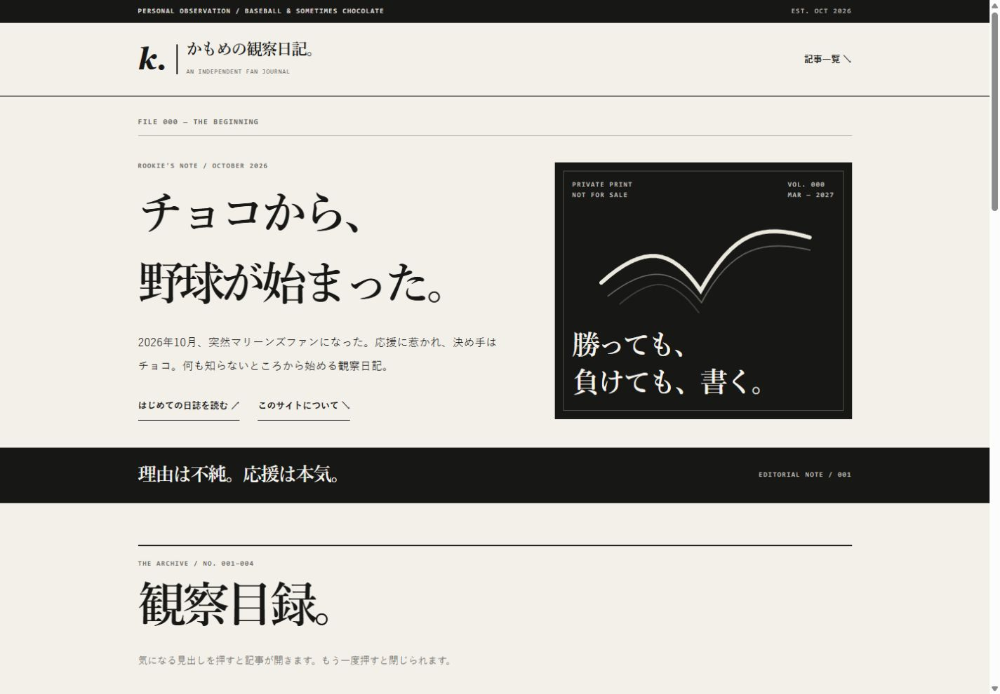
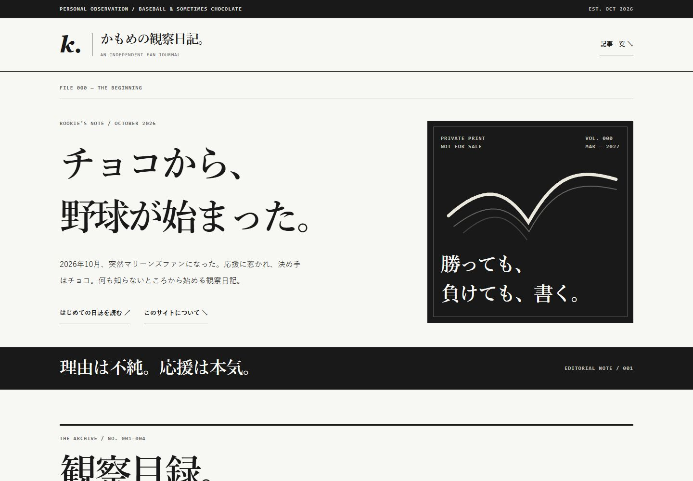
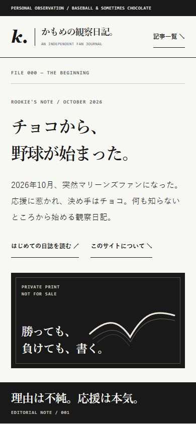
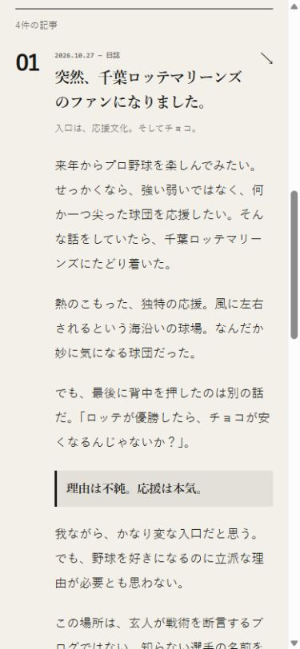
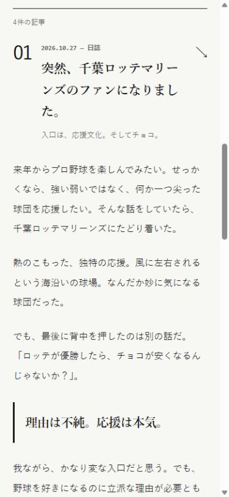

# 誌面と読書体験の改善レビュー

## 既存デザインの観察

明朝体、罫線、k. の署名、オリジナルのかもめ線画、黒い表紙、記事番号の並びをサイトの核として維持した。

- スマホでは記事本文にも番号用の左余白が残り、390pxの画面で本文が284pxに狭まっていた。
- 日付・補助文字・カテゴリ操作が小さく、情報の確認とタップが難しかった。
- PCは横幅と見出しのサイズが控えめで、誌面の強弱をさらに出せる余地があった。
- 紙色の黄味を抑え、白・黒・グレーの編集方針に近づける余地があった。

## 実装

- PCの誌面幅を1320pxに、ヒーロー見出しを最大78pxに拡張。表紙と見出しの比率、余白、罫線を調整。
- 700px以下は縦組みのレイアウト構成（文字自体は横書き）。記事本文の左インデントを取り除き、16px・行高2.1を確保。
- 日付と補助文字を拡大。カテゴリボタンと主要リンクに44px以上の高さを確保。
- 引用は背景色の箱から罫線と余白の表現に変更。
- フォーカス表示、reduced-motion、スキップリンク、ネイティブdetailsを維持。
- 記事ハッシュへの移動時に絞り込みを解除し、対象記事を開く。JavaScriptが動かない場合は機能しない絞り込みUIを表示しない。
- 記事本文・出典HTMLは変更前との完全一致をスクリプトで確認。スローガン、線画、非公式表記も維持。

## 表示・操作検証

2026-10-30、接続ブラウザー（Chromium）でローカルHTTPの実ファイルを確認。

| ビューポート | 結果 |
| --- | --- |
| 320 × 812 | 横はみ出しなし |
| 390 × 844 | 横はみ出しなし、本文16px、有効幅331px（従来284px） |
| 844 × 390（横画面） | 横はみ出しなし |
| 768 × 1024 | 横はみ出しなし |
| 1024 × 768 | 横はみ出しなし |
| 1440 × 1000 | 横はみ出しなし、本文17px |

- 「チームを知る」選択で対象の2件だけが表示され、押下状態と件数が更新される。
- 記事summaryをEnterで開ける。フォーカスのアウトラインが表示される。
- `#note-04`への直接アクセスで記事が開き、表示される。
- 取得したブラウザーの警告・エラーログは0件。
- h1は1つ、主要セクションはh2。SVGには代替説明、絞り込み件数にはaria-liveを維持。

## アクセシビリティ・性能

計算によるコントラスト比：本文 #191919 / #f7f7f4 は16.38:1、補助文字 #62625f / #f7f7f4 は5.70:1、表紙の補助文字 #c2c2bb / #191919 は9.82:1。通常文字のWCAG AA基準4.5:1を上回る。

HTMLは25,356 → 26,292 bytes。Node標準gzipで9,025 → 9,264 bytes（+239 bytes）。追加のライブラリ・外部フォント・画像通信はなし。CSS/JS/SVGは引き続きインライン、faviconは既存のローカルSVG。ビルド・依存インストールなしでGitHub Pagesに配信できる。比較画像はレビュー資料であり、トップページから読み込まれない。

`git diff --check`、JS構文検査、本文と出典の一致検査を実施。Lighthouse、実回線でのLCP/CLS/INP、スクリーンリーダー、実機iPhone/Safariは未検証。上記はChromiumの画面幅検証であり、iOS実機の動作保証やWCAG全項目の適合判定ではない。

## 比較画像

1440 × 1000、390 × 844、等倍表示で撮影。ページの文章は同一。

| 対象 | 改善前 | 改善後 |
| --- | --- | --- |
| PC先頭 |  |  |
| スマホ先頭 |  |  |
| スマホ記事 |  |  |

## 公開

別ブランチのPRとして提出。mainへの直接push・マージ・自動マージ・公開操作は行わない。人間編集長が比較と内容を確認し、承認後にマージして既存のGitHub Pagesで公開する。
