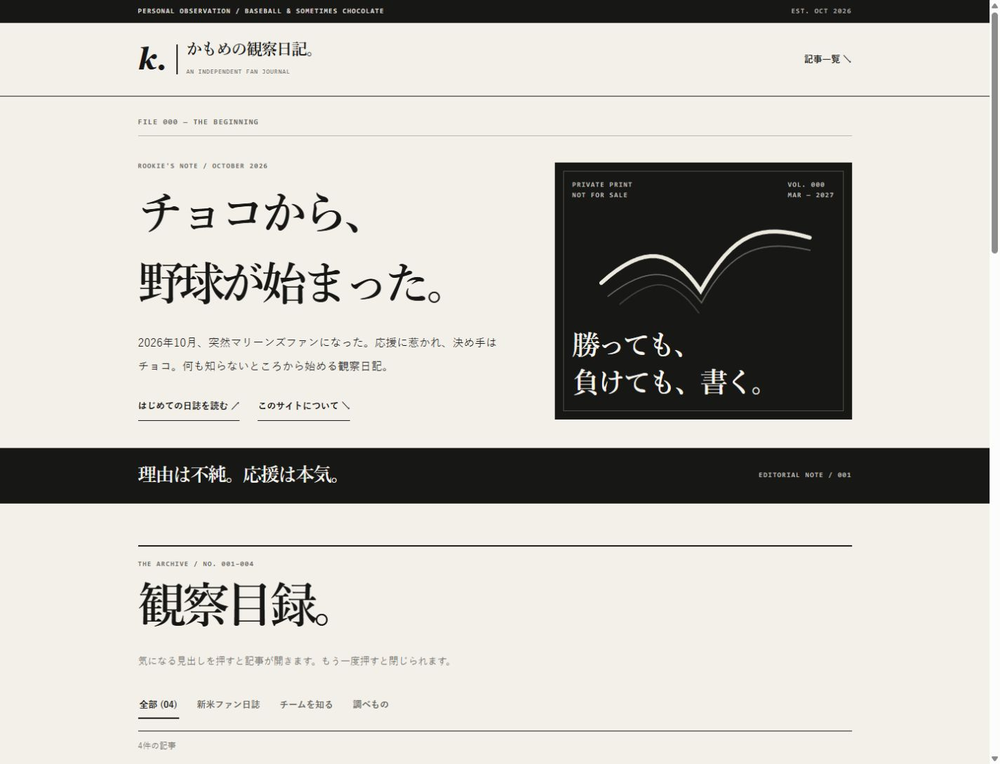
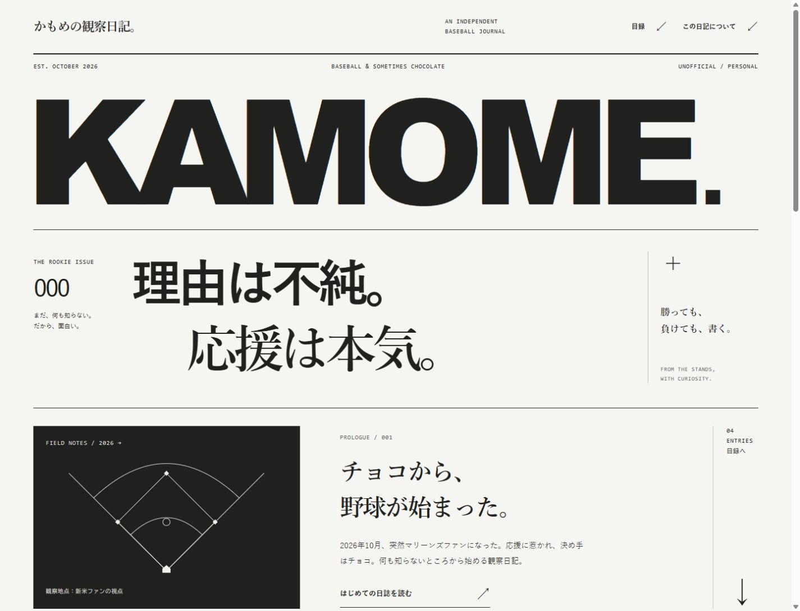
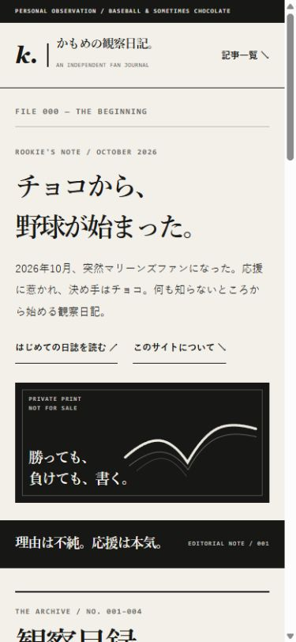
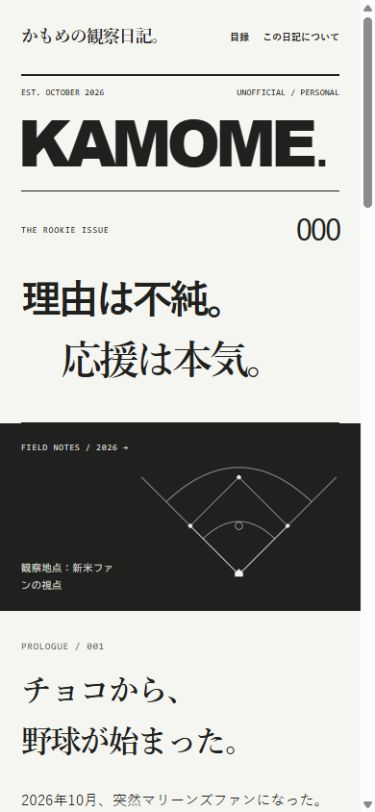
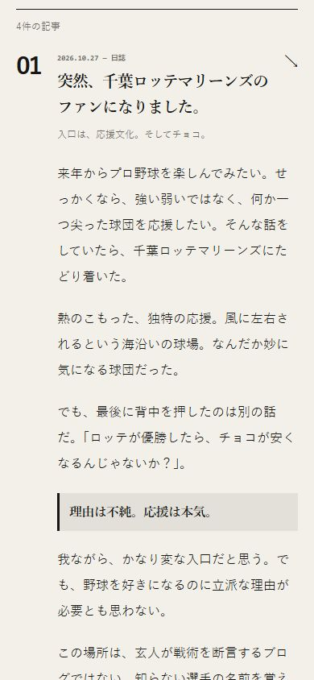
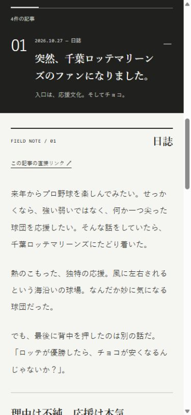
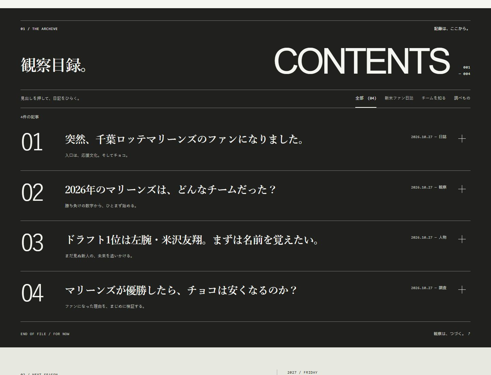
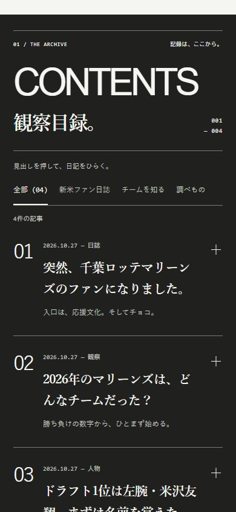

# SPORTS ZINE × EDITORIAL — フルリデザイン

## デザインの意図

既存の「小さな誌面を整える」方向から離れ、表紙、目次、読書面、奥付という編集物の構成に再設計した。

- **表紙**：巨大な `KAMOME.` を誌名として配置。ゴシックの「理由は不純。」と、一段ずらした明朝の「応援は本気。」を組み合わせ、新米ファンの軽い入口と本気の応援を表現。
- **非対称グリッド**：号数、宣言、編集メモを異なる幅で配分。導入部は球場図・文章・目録への矢印の3つの領域で構成。
- **野球の抽象表現**：オリジナルのインラインSVGでダイヤモンドとファウルラインを描画。号数・記事番号・日付は編集上の番号として扱い、架空の試合成績やニュースは加えていない。
- **目次**：黒地、細い罫線、大きな記事番号、右に寄せた日付。カード・影・角丸・写真に頼らず、文字の大小と整列で一覧を構成。
- **読書面**：記事を開くと白い紙面へ切り替わる。PCは分類・直接リンクを左、本文を右に置き、本文幅は最大680px。スマホは本文を全幅で読み、16px・行高2.15を確保する。
- **スマホのスクロール**：短い表紙、全面幅の球場図、導入文、黒い目次、淡い日付面、奥付へと背景と密度を変える。PCのレイアウトを縮めた構成にはしていない。

初期状態では4記事を閉じ、目次全体を見渡せるように変更した。見出し・Enterで開閉でき、従来の `#note-01` 〜 `#note-04` は対象記事を開く。複数の記事を同時に開ける。

## 守った内容

サイト名、スローガン、4記事の本文と出典、見出し・要約、非公式表記、新米ファンの視点を維持。公式ロゴ・選手写真・球団素材は追加していない。

本文と出典のHTMLは、mainのコミット `317353694dd254f199d5942cc9c2f4f38cb4c093` と一致する（改行コードの違いのみ正規化）。将来の変更でも検査できるよう、元の記事のSHA-256を使う検証スクリプトを追加した。

```sh
node scripts/verify-content.mjs
node --check journal.js
git diff --check
```

記事の内容を意図的に改訂する場合は、その編集内容の承認後に検証用ハッシュも更新する。

## 技術的な変更

- `index.html`：セマンティックなheader/main/section/footerと、新しい誌面構成。記事は引き続きネイティブのdetails/summary。
- `styles.css`：画面幅に応じたグリッド、文字組み、白黒の誌面、読書面。外部フォント・CSSフレームワーク・アニメーションライブラリなし。
- `journal.js`：deferで読み込む小さな通常のスクリプト。カテゴリ絞り込み、件数通知、開閉ラベル、ハッシュ記事表示、既存カウントダウンを扱う。
- JavaScriptなしでも記事を開ける。動かない絞り込みボタンは表示せず、開幕予定日は静的テキストとして残す。
- 相対パスの静的3ファイルと既存favicon、`.nojekyll`を使用。ビルド・パッケージインストール・サーバー処理なしでGitHub Pagesに対応。
- 既存のdescription、OGP、robots、lang、viewportを維持。計測・広告・通信先の追加なし。

## ブラウザー確認

2026-10-30、ローカルHTTP上で接続ブラウザー（Chromium）を使用。

| 画面幅 | 確認結果 |
| --- | --- |
| 320 / 375 / 390 / 430px | 全記事を開いても本文・見出し・誌名の横はみ出しなし |
| 700 / 701px | スマホとタブレットの境界で横はみ出しなし |
| 768 / 844 / 1024px | 横はみ出しなし。844 × 390で横画面も確認 |
| 1440 / 1920px | 非対称グリッドと本文幅上限を確認、横はみ出しなし |

- 「チームを知る」で記事02・03の2件が表示され、件数とaria-pressedが更新される。
- Enterで記事を開閉でき、開閉ラベルとフォーカスの枠が更新される。
- 絞り込み後でも「はじめての日誌を読む」で全件を表示し、記事01を開く。
- `#note-04`への直接アクセスで記事04が開く。
- JS読み込みを省いたローカル検証ページでも、記事01をEnterで開ける。絞り込みUIは非表示、予定日は表示。
- 取得したブラウザーの警告・エラーログは0件。

## アクセシビリティ・性能

- h1は1つ。mainへのスキップリンクとランドマークを維持し、mainはキーボードで移動先にできる。
- 空のリンク名・重複ID・存在しない内部リンクはなし。装飾の英字誌名と球場図はaria-hidden。
- フィルタはスマホで48pxの高さ。本文はスマホ16px、PC17px。390px幅の本文有効幅は331px（mainは284px）。
- 文字のコントラスト：本文14.79:1、白地の補助文字5.48:1、黒地の補助文字9.73:1。通常文字のWCAG AA基準4.5:1を上回る。
- 過剰なアニメーションは使用せず、prefers-reduced-motion時はスムーズスクロールを停止。
- 配信ファイルの合計は25,236 → 34,252 bytes、各ファイルのgzip合計は9,013 → 10,853 bytes（+1,840 bytes）。CSS/JSを分けることでキャッシュ可能にした。実際のGitHub Pagesの圧縮・キャッシュ条件は未計測。
- ローカル・無スロットリング・390 × 844の参考測定：改修後LCP 56ms / CLS 0、main LCP 148ms / CLS 0。各1回の計測であり、速度改善を証明する比較ではない。改修後のリソースは同一オリジンのCSS、JS、faviconのみ。計測コードはローカルの検証用ページだけに置き、コミットしていない。

実機iPhone/Safari、スクリーンリーダー、Lighthouse、低速回線、INPは未検証。画面幅の検証は実機テストの代わりではなく、上記の確認もWCAG全項目の適合認定ではない。

## 比較画像

同じmainを基準に、PCは1440 × 1100、スマホは390 × 844で撮影。PR #1の画面との比較ではない。

| 対象 | main | フルリデザイン |
| --- | --- | --- |
| PC表紙 |  |  |
| スマホ表紙 |  |  |
| スマホ本文 |  |  |

### 新しい目次





## 提出・公開

現行mainから作成した `design/sports-zine-redesign` で提出。既存PR #1とそのブランチは変更していない。mainへの直接変更、マージ、自動マージ、本番公開は行わない。人間編集長の承認とマージ後に、既存のGitHub Pages運用で公開する。
